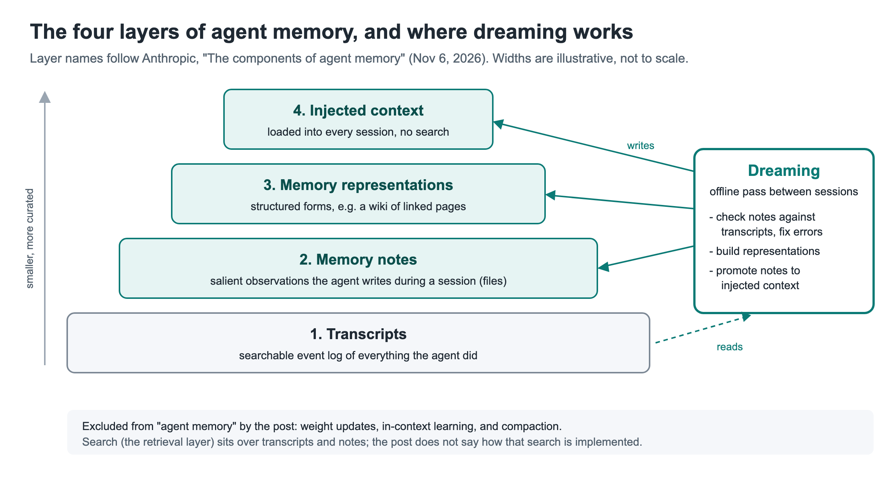
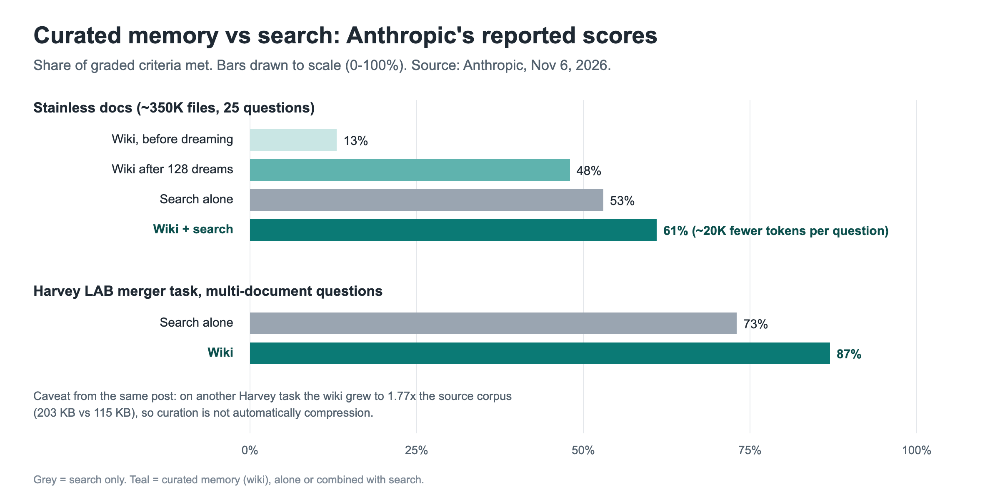
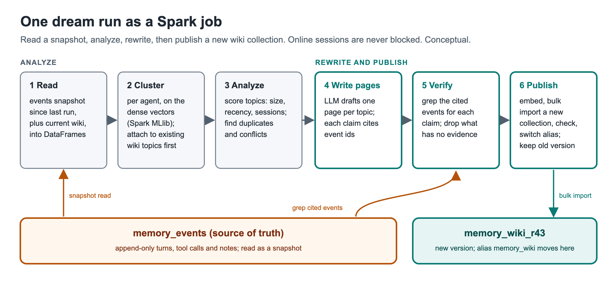

**Agent memory** is what an agent learns from its own work and keeps across sessions. Anthropic's November 6, 2026 essay splits it into four layers (transcripts, notes, representations, injected context) plus an offline "dreaming" pass that curates them. Its headline result for retrieval builders: curated memory combined with search scored higher than search alone.

*Last updated: November 2026*

## Key takeaways

- Anthropic's essay "[The components of agent memory](https://www.anthropic.com/research/components-of-agent-memory)" (Nov 6, 2026) defines a four-layer memory hierarchy and excludes weight updates, in-context learning, and compaction from "agent memory".
- On a ~350,000-file documentation corpus, a dreamed wiki plus search met 61% of graded criteria, versus 53% for search alone, and used about 20,000 fewer tokens per question (Anthropic, Nov 6, 2026).
- Search did not go away. The best configuration in the essay kept a search layer under the curated layers.
- Dreaming is a real API: an asynchronous job over one memory store and 1 to 100 past sessions, in research preview on the Claude API ([Anthropic docs](https://platform.claude.com/docs/en/managed-agents/dreams), accessed Nov 19, 2026).
- If you build your own, Milvus can be the only store: an append-only event collection you grep for details, a wiki collection you search for direction, and a Spark job that rebuilds the wiki offline. The design is below.

## What did Anthropic actually publish?

Anthropic published an engineering essay, not a new model. Written by Lance Martin and dated November 6, 2026, it explains how Claude's memory features fit together and reports experiments on several benchmarks. The dreaming feature itself was announced earlier, at Code with Claude in May 2026 ([SiliconANGLE, May 6, 2026](https://siliconangle.com/?p=748056)); the November essay is what put the design and the numbers in public.

Its definition is narrow on purpose: not fine-tuning, not in-context learning, and not compaction (summaries that replace older turns in a fresh context window).

*Figure 1. The memory hierarchy described in Anthropic's essay. Layer widths are illustrative.*

## What are the four layers of agent memory?

The four layers run from raw and large to curated and small. From the bottom:

1. **Transcripts.** A searchable event log of what the agent did.
2. **Memory notes.** Salient observations the agent writes during a session, usually files in a memory folder or store.
3. **Memory representations.** Structured forms built from notes, such as a wiki of linked pages.
4. **Injected context.** A small layer loaded into every new session so the agent never has to search for it. The essay notes that Claude Code's auto memory loads only the first 200 lines or 25 KB of `MEMORY.md`.

**Dreaming** is the process that connects the layers. Between sessions, Claude rereads transcripts and existing notes, corrects notes that turned out wrong, builds representations, and promotes what matters into injected context. The essay credits the idea to sleep-time compute research from Letta and UC Berkeley ([arXiv 2504.13171](https://arxiv.org/abs/2504.13171)).

## Does curated memory beat search?

On the essay's own tasks, curated memory plus search beat search alone, and curated memory alone sometimes did too. The numbers below are Anthropic's, from the November 6 essay; the essay does not publish confidence intervals, and some comparisons come from a small number of runs.

| Task (Anthropic, Nov 6, 2026) | Search alone | Curated memory | Curated + search |
|---|---|---|---|
| Stainless docs, ~350K files (~420M tokens), 25 questions | 53% | 48% (wiki after 128 dreaming sessions; 13% at start) | **61%**, ~20K fewer tokens per question |
| Harvey LAB merger task, multi-document questions | 73% | **87%** (wiki) | not reported |
| CL-Bench database task, Opus 5.5 mean reward | 0.655 (no memory) | **0.838** (with memory) | n/a |

*Figure 2. Reported scores from Anthropic's essay, drawn to scale.*

Two caveats from the same essay: on another Harvey task the wiki grew to 1.77x its source corpus (203 KB vs 115 KB), and recording only failures cut Opus 5's CL-Bench gain by 0.234. What the agent chooses to write matters.

## Is agent memory the same as RAG?

No, but they share the retrieval step. [RAG](https://zilliz.com/learn/Retrieval-Augmented-Generation) retrieves from a corpus someone else wrote; agent memory retrieves from what the agent wrote about its own work, and adds a write path and a curation step.

The essay keeps search in the picture (searchable transcripts, and search in the best Stainless result) but does **not** say how that search works. It mentions file, text and transcript search, and never mentions embeddings or vector search. Anthropic's managed memory stores are mounted into the agent's sandbox as a directory under `/mnt/memory/` and read with the standard agent file tools ([memory docs](https://platform.claude.com/docs/en/managed-agents/memory), accessed Nov 19, 2026). So treat any claim that "Anthropic uses vector search for memory" as unsupported.

## How do you build agent memory on Milvus?

Anthropic's managed memory stores are files in a sandbox. A self-built memory does not need files at all: Milvus can be the only store, for raw history and for the curated wiki. The design below uses two collections and two ways to search them: **search the wiki for direction, grep the event log for details.** It is a reference design, not a benchmarked system; thresholds called starting points need tuning on your own data.

### Architecture

*Figure 3. Two collections, two ways to search, one offline job. Conceptual.*

- **`memory_events`** is the raw base: every turn, tool call and note, append-only. It is the source of truth.
- **`memory_wiki`** is what dreaming produces: one page per topic plus a few injected facts. Sessions read it through an [alias](https://milvus.io/docs/manage-aliases.md) that points at the current version.
- **Online**, a session appends to `memory_events`, searches the wiki to find the right topic, and greps the events for exact details.
- **Offline**, a dream job reads a snapshot of `memory_events`, builds a new wiki version as a new collection, and switches the alias. Sessions never wait for it.

### Schema: two collections

`memory_events`, written online, never edited:

| Field | Type | Purpose |
|---|---|---|
| `event_id` | VARCHAR, primary key | Unique per event |
| `agent_id` | VARCHAR, [partition key](https://milvus.io/docs/use-partition-key.md) | One tenant per agent or user; every request filters on it |
| `session_id` | VARCHAR | Session the event belongs to |
| `created_at` | INT64 | Epoch milliseconds; time windows and ordering |
| `kind` | VARCHAR | `turn`, `tool_call` or `note` |
| `text` | VARCHAR, analyzer and match enabled | The content; input to BM25, keyword match (`TEXT_MATCH` needs both `enable_analyzer` and `enable_match`) and substring match |
| `dense` | FLOAT_VECTOR | Embedding of `text` |
| `sparse` | SPARSE_FLOAT_VECTOR | Generated by Milvus's [BM25 function](https://milvus.io/docs/full-text-search.md) from `text` |
| `meta` | [JSON](https://milvus.io/docs/json-field-overview.md) | Tool name, exit code, file paths, error codes |

`memory_wiki_<run>`, written by one dream run, read-only afterwards:

| Field | Type | Purpose |
|---|---|---|
| `page_id` | VARCHAR, primary key | Stable per topic, so a page keeps its id across versions |
| `agent_id` | VARCHAR, partition key | Same tenant boundary as the events |
| `kind` | VARCHAR | `wiki` (a topic page) or `injected` (a short fact loaded at session start) |
| `title`, `text` | VARCHAR | The page; `text` has the analyzer on |
| `dense`, `sparse` | vectors | Embedding and BM25 of the page, for hybrid search |
| `source_event_ids` | ARRAY of VARCHAR | Events the page is based on: the path from summary back to evidence |
| `support_count`, `session_count`, `last_seen_at` | INT64 | How much evidence, from how many sessions, how recent |
| `dream_run_id` | VARCHAR | Which run produced this version |

Indexes: a vector index on `dense` and a sparse inverted index on `sparse` in both collections; on `memory_events`, an [NGRAM index](https://milvus.io/docs/ngram.md) on `text` for substring matches, and scalar indexes on `kind` and `created_at`.

Why two collections instead of one with a layer field:

- **Different lifecycles.** Events arrive one by one, all day. The wiki is recomputed in bulk. Keeping them apart means a dream rewrite never competes with live writes.
- **Atomic publish and rollback.** Each run writes a complete new wiki collection; the alias moves only after checks pass, and the previous version stays for rollback.
- **The raw log stays immutable.** Nothing in `memory_events` has to be marked or rewritten after a dream. Which events a page absorbed is recorded once, in `source_event_ids`.
- **It matches how batch engines write to Milvus.** Bulk-importing a new collection is the natural output of a Spark job, and far cheaper than row-by-row updates.

### Write path

Only `memory_events` is written online. Each turn and tool call becomes one row (long tool output split into chunks), and a note is a row with `kind = note`. Your application computes `dense` at write time; Milvus computes the BM25 vector and maintains the NGRAM index, so a new error code or file path is greppable as soon as the row lands. Notes are not deduplicated at write time; that is the dream job's work, which keeps the hot path a plain insert.

### Search: the wiki for direction, grep for details

The two collections answer different questions, and an agent uses both.

**Search the wiki for direction.** "What do we know about releases?" or "what is related to this failure?" is a semantic question. A [hybrid search](https://milvus.io/docs/multi-vector-search.md) on `memory_wiki` (dense plus BM25, fused with the [RRF ranker](https://milvus.io/docs/rrf-ranker.md)) returns the right topic pages, and the nearest other pages show what is related. Each hit carries `source_event_ids`: where the evidence lives.

**Grep the events for details.** "What exactly did the signer print?" or "which command fixed it?" needs the original text, not a summary. On `memory_events` this is filtering, not similarity:

- [keyword match](https://milvus.io/docs/keyword-match.md) (`TEXT_MATCH`) for whole tokens such as `E1042`;
- `LIKE` patterns, accelerated by the NGRAM index, for fragments such as part of a path or a function name;
- [JSON filters](https://milvus.io/docs/json-field-overview.md) on `meta`, for example failed tool calls only;
- time ranges and `session_id`, returned in time order.

**Combine them.** A typical recall searches the wiki first, then greps only inside the events that page cites, or the sessions around them. The wiki tells the agent where to look; grep reads what actually happened. If the wiki has nothing yet (a topic newer than the last dream), the agent greps and hybrid-searches recent events directly. Injected facts are not searched at all; they are loaded at session start with a plain filter on `kind == "injected"`.

This mirrors the essay's best configuration: curated memory on top, with search over the raw material underneath. A summary can be stale or wrong; the events are what happened. We have not yet measured how much each part contributes on real agent transcripts, so treat the split as a starting point to test on your own workload.

### Running dreaming offline with Spark

*Figure 4. One dream run as a Spark job. Conceptual.*

Dreaming is a batch job over a large table, which is what Spark is for. The [Spark connector for Milvus](https://milvus.io/docs/integrate_with_spark.md) reads a collection into a DataFrame and writes DataFrames back through bulk import, including to Zilliz Cloud, with a Databricks setup documented. One run:

1. **Read.** Load a snapshot of `memory_events` since the last run, plus the current wiki version, into DataFrames. The job works on a fixed copy, so live sessions keep writing.
2. **Cluster.** Per agent, cluster the event vectors with Spark MLlib (for example k-means). Events close to an existing wiki page join that page's topic instead of starting a new one, so page ids stay stable.
3. **Analyze.** Score each topic by size, recency and the number of sessions involved. Find near-duplicate notes, and pairs that are close but disagree, such as two different fixes for the same error; time order and evidence decide which is current.
4. **Write pages.** For each changed topic, call an LLM from the executors to write or update one page: what is true now, how to do it, known failures. Each claim cites the event ids it came from.
5. **Verify.** Check every claim against the events it cites, the same grep an agent would run. Claims with no evidence are dropped. This is the "correct notes against transcripts" step the essay describes.
6. **Publish.** Embed the pages, carry unchanged pages forward, write the result as a new collection `memory_wiki_<run>` by bulk import, check row counts and a few known queries, then switch the alias. Keep the previous version for rollback. The most-used facts across sessions become `injected` rows, within a fixed budget (Claude Code's equivalent is the first 200 lines or 25 KB of `MEMORY.md`).

Schedule it nightly, or after a set number of new sessions per agent. Each run only recomputes agents with new events; everything else is copied forward. Any engine that can read a collection snapshot and bulk-import a new collection fits the same pattern; we use Spark here because its Milvus connector is public and documented.

Watch the size of what you generate. On one Harvey task in Anthropic's essay the wiki grew to 1.77x its source corpus, so cap page length and track the wiki-to-events ratio per agent.

## Should you use Anthropic's managed dreaming or build your own?

Use managed dreaming if you already run Claude Managed Agents and want curation without owning a pipeline. Build your own if you need a different model, your own search, or control over data handling. The facts that decide it, from Anthropic's [dreams documentation](https://platform.claude.com/docs/en/managed-agents/dreams) as of November 19, 2026:

| Question | Managed dreaming (Anthropic) | Self-built (e.g. Milvus + a Spark dream job) |
|---|---|---|
| Status | Research preview; access by request | Whatever you ship |
| Inputs | One memory store plus 1 to 100 sessions | Anything you log |
| Output | A new memory store; input never modified | Your choice; keep old versions for rollback |
| Runtime | Minutes to a few hours, asynchronous | Depends on your job |
| Cost | Standard token rates for the chosen model | Model tokens plus index storage and compute |
| Data handling | Not eligible for ZDR except self-hosted Managed Agents; not HIPAA-eligible | Your infrastructure, your policy |
| Search over memory | File tools in the sandbox; no vector index documented | Hybrid search on the wiki, grep (keyword, substring, JSON filters) on the events |

The docs also link a cookbook recipe for running your own dream. The two can combine: a managed or self-run dream curates the memory, and Milvus keeps every layer searchable.

## Try it

Prototype the full design on [Milvus Standalone](https://milvus.io/docs/install_standalone-docker.md) in Docker, or on a [free Zilliz Cloud cluster](https://cloud.zilliz.com/signup) (Zilliz Cloud is managed Milvus). Milvus Lite is too limited here: the design relies on an NGRAM index and on Spark bulk import, which need a server deployment. For the database, see [Milvus on GitHub](https://github.com/milvus-io/milvus); for the offline job, the [Spark connector guide](https://milvus.io/docs/integrate_with_spark.md).

## FAQ

### What is agent memory?

Agent memory is knowledge an AI agent gains from its own work and keeps across sessions. Anthropic's November 6, 2026 essay organizes it into four layers: searchable transcripts, memory notes the agent writes, structured representations such as a wiki, and a small injected context loaded at the start of every session. It excludes fine-tuning, in-context learning, and compaction.

### What is Claude dreaming?

Dreaming is an offline process in which Claude reviews past session transcripts and an existing memory store, then produces a reorganized store: duplicates merged, stale or contradicted entries replaced, and new insights added. In the Claude API it is an asynchronous job over one memory store and 1 to 100 sessions, in research preview as of November 2026. The input store is never modified.

### Does agent memory replace RAG or vector search?

Not according to Anthropic's own results. On a documentation corpus of about 350,000 files, a dreamed wiki plus search met 61% of graded criteria versus 53% for search alone, and the wiki alone reached 48%. Curated memory reduces how much an agent has to search, but the best result kept a search layer over the raw material.

### How do I build agent memory on Milvus?

Use two collections. An append-only `memory_events` collection holds every turn, tool call and note; agents grep it for exact details with keyword match, substring match and JSON filters. A `memory_wiki` collection holds one page per topic; agents search it with hybrid dense and BM25 search to find direction and related topics. An offline Spark job clusters the events, writes and verifies wiki pages, bulk imports them as a new collection version and switches an alias, so sessions are never blocked and every version can be rolled back.
