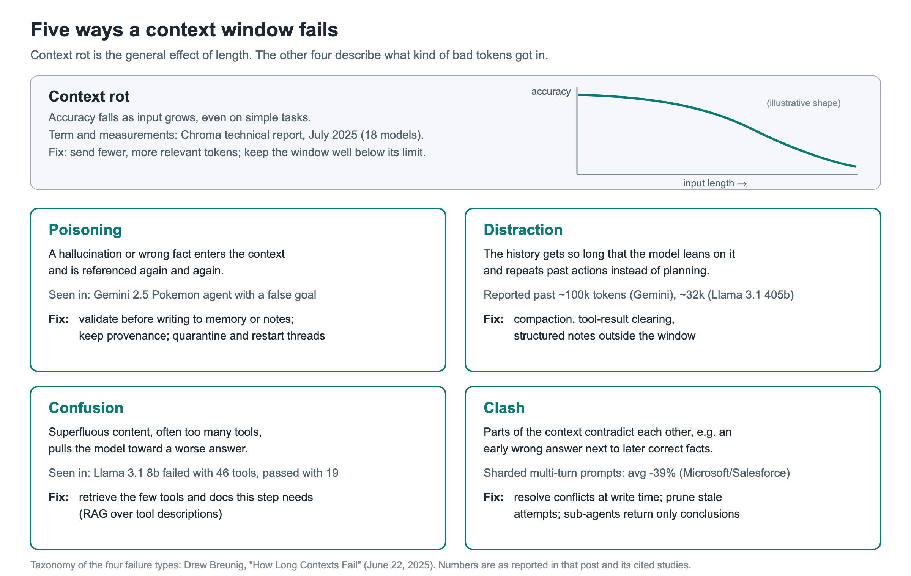
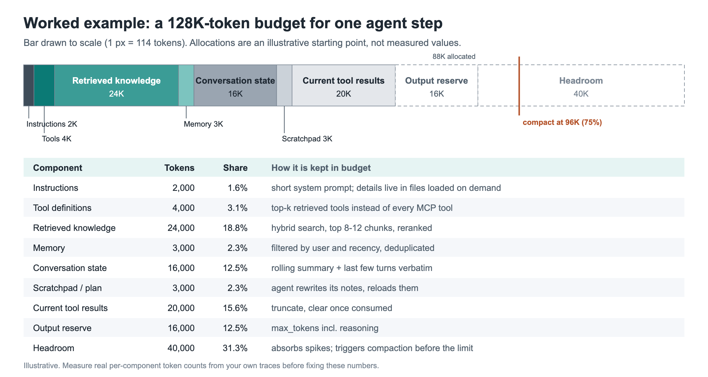

**Context engineering is the work of deciding which tokens an LLM sees on each call: instructions, tool definitions, retrieved knowledge, memory, conversation state, and notes. Prompt engineering tunes the wording of one instruction; context engineering builds the system that assembles, trims, and refreshes everything around it, step after step, within a fixed token budget.**

*Last updated: November 2026*

An agent that runs for 50 steps makes 50 model calls, each with a different context. Many agent failures are not "the model is not smart enough" but "the model was shown the wrong things": 40 tool schemas it did not need, a stale error from step 3, a summary that dropped the one constraint that mattered. This guide covers what goes into agent context, how it fails, the fixes, a worked token budget, and how to build the select step on [Milvus](https://milvus.io/docs/quickstart.md): schema, write path and the per-step read path.

**Key takeaways**

- Context engineering decides *what the model sees*; prompt engineering decides *how one instruction is phrased*. The first contains the second.
- Longer context is not free. Chroma measured accuracy dropping as input grows across 18 models, even on simple tasks ([Chroma, July 2025](https://www.trychroma.com/research/context-rot)).
- Bad context fails in named ways: rot, poisoning, distraction, confusion, and clash. Each has a different fix.
- Most techniques fall into four moves: write context out, select it back in, compress it, or isolate it in a separate window.
- Give every component a token budget and leave headroom. Retrieval (tools, documents, memory, code) is how you keep the dynamic parts small.

## What is context engineering?

Context engineering is the practice of curating the full set of tokens an LLM receives at inference time so that the next step is likely to succeed. Anthropic describes it as strategies for "curating and maintaining the optimal set of tokens" during inference ([Anthropic, Sept 29, 2025](https://www.anthropic.com/engineering/effective-context-engineering-for-ai-agents)).

The term spread in June 2025. Shopify CEO Tobi Lütke [wrote](https://x.com/tobi/status/1935533422589399127) that he preferred "context engineering" to prompt engineering because it names the core skill better: giving the model everything it needs for the task to be plausibly solvable. Andrej Karpathy [agreed a week later](https://x.com/karpathy/status/1937902205765607626), describing industrial LLM apps as filling the context window with just the right information for the next step.

It matters more for agents than for chatbots because of the loop: an agent assembles context on every tool call, and every tool result becomes input to the next call. Whatever you let in compounds.

*Figure 1. One prompt versus a context rebuilt on every step. Conceptual.*

## Context engineering vs prompt engineering: what is the difference?

Prompt engineering optimizes the instruction text. Context engineering optimizes the whole input and the system that produces it. You still write good prompts inside a context-engineered system; you just stop expecting the prompt to carry information it cannot hold.

| | Prompt engineering | Context engineering |
|---|---|---|
| Core question | How should I phrase this? | What should the model see at this step? |
| Unit of work | One prompt or template | Every model call in a multi-step run |
| Main inputs | Instructions, examples, output format | Instructions + tools + retrieved data + memory + history + notes |
| Typical failure | Ambiguous or underspecified instruction | Missing fact, irrelevant tokens, stale or contradictory state |
| Tools you use | Prompt templates, few-shot examples, evals | Retrieval, vector search, summarizers, memory stores, sub-agents, token counters, traces |
| How you debug | Rewrite and re-run the prompt | Inspect the assembled context in a trace, then fix the pipeline that built it |

A rule of thumb: if the task can be solved with information you can paste into one prompt, prompt engineering is enough. Once the agent needs external knowledge, continuity across turns, or more tools than fit comfortably, the bottleneck moves to context.

## What goes into an agent's context window?

An agent's context window has six parts, plus space reserved for the answer. Some are static and change rarely; the rest are assembled per step by your code.

*Figure 2. The six parts of agent context and where each comes from. Teal parts are typically served by a vector index.*

1. **Instructions.** System prompt, role, rules, output format, and project files such as `AGENTS.md` or `CLAUDE.md`. Stable across a session, so put them first: providers that support prompt caching reuse an unchanged prefix.
2. **Tool definitions.** Name, description, and JSON schema for each callable tool. These are easy to underestimate: connect a few MCP servers and you can ship dozens of schemas on every call.
3. **Retrieved knowledge.** Documentation, tickets, code chunks, database rows fetched for this step.
4. **Memory.** Facts and preferences that outlive the session: what the user decided last week, which approach already failed. We cover the storage side in [Agent Memory After Anthropic's "Dreaming" Essay](https://milvus.io/blog/agent-memory-dreaming-retrieval.md).
5. **Conversation state.** User turns, the agent's own messages, tool calls, and tool results. This is the part that grows every turn.
6. **Scratchpad.** The agent's plan, todo list, and working notes, ideally kept as one record it can rewrite rather than scattered through history.

The remaining space is for the model's output, including any reasoning tokens. Never plan to fill the window to 100%.

## Why do long contexts fail?

Long contexts fail because models do not use every token equally, and because bad tokens, once in the window, keep influencing later steps. Five named failure modes cover most of what goes wrong.

*Figure 3. Context rot is the general effect of length; the other four describe which kind of bad token got in.*

**Context rot.** The term comes from Chroma's technical report [*Context Rot: How Increasing Input Tokens Impacts LLM Performance*](https://www.trychroma.com/research/context-rot) (Hong, Troynikov, Huber; July 14, 2025). Across 18 models, performance became less reliable as input length grew, even on simple retrieval tasks. Distractors made it worse, and on LongMemEval every model scored higher on a focused prompt of about 300 tokens than on the full prompt of about 113k tokens. An older result points the same way: models retrieve information at the start and end of a long input better than in the middle ([Liu et al., "Lost in the Middle", 2023](https://arxiv.org/abs/2307.03172)). For a deeper look at why rot happens and retrieval strategies against it, see [Keeping AI Agents Grounded: Context Engineering Strategies that Prevent Context Rot](https://milvus.io/blog/keeping-ai-agents-grounded-context-engineering-strategies-that-prevent-context-rot-using-milvus.md).

The other four names come from Drew Breunig's post [*How Long Contexts Fail*](https://www.dbreunig.com/2025/06/22/how-contexts-fail-and-how-to-fix-them.html) (June 22, 2025), which credits the DeepMind Gemini 2.5 report for calling out poisoning:

- **Context poisoning.** A hallucination or wrong fact enters the context and gets referenced again and again. The Gemini 2.5 Pokemon agent pursued impossible goals after misinformation about the game state got into its notes.
- **Context distraction.** History grows so long that the model leans on it instead of its training, repeating past actions. Breunig cites the Gemini agent beyond about 100k tokens (anecdotal) and a Databricks study where Llama 3.1 405b correctness started to fall around 32k tokens.
- **Context confusion.** Superfluous content, often too many tools, lowers answer quality. In one study he cites, a quantized Llama 3.1 8b failed a task with 46 tools available and succeeded with 19.
- **Context clash.** Parts of the context contradict each other, typically an early wrong attempt next to later correct information. When Microsoft and Salesforce researchers split benchmark prompts across multiple turns, performance fell 39% on average ([Laban et al., 2025](https://arxiv.org/abs/2505.06120)).

Treat these as a debugging vocabulary: open the trace, read the exact context of the failing step, and name which of the five you are looking at.

## Context engineering techniques that work

Almost every technique does one of four things: writes context out of the window, selects it back in, compresses it, or isolates it in a separate window. This grouping comes from LangChain's [*Context Engineering for Agents*](https://www.langchain.com/blog/context-engineering-for-agents) (July 2, 2025); Anthropic's guide describes the same set as compaction, note-taking, sub-agents, and just-in-time retrieval.

*Figure 4. Techniques grouped by what they do to the context window. Teal items are vector database workloads.*

### Retrieval and just-in-time loading (select)

Keep lightweight references in context, such as file paths, IDs, or search queries, and load the content only when the agent needs it. Coding agents do this with `grep` and file reads. For anything that is not addressable by exact name (a design doc that discusses "rate limiting" without using your search term, a memory from three weeks ago, the right tool among 200), you need semantic retrieval: embed the query, search an index, and put the top few results into context. Hybrid retrieval that combines dense vectors with [BM25 full-text search](https://milvus.io/docs/full-text-search.md) catches both paraphrases and exact identifiers.

Retrieval is also the main fix for confusion. Fewer, more relevant chunks beat more chunks.

### Compaction and summarization (compress)

When history approaches a threshold, summarize it and continue from the summary. Anthropic recommends starting with the lightest form: clearing old tool results that the agent has already acted on. Compaction is lossy, and a bad summary can poison every later step, so keep recent turns verbatim, preserve decisions and open questions explicitly, and test your summarizer prompt against traces the same way you test anything else.

*Figure 5. Compaction, lightest step first. Heights illustrative.*

### Sub-agents and isolation (isolate)

Hand a focused task to a sub-agent with its own clean window and have it return only a condensed result. Anthropic reports sub-agents that explore with tens of thousands of tokens typically return 1,000 to 2,000 tokens to the lead agent. Isolation is the strongest fix for clash: the failed attempts stay in the sub-agent's window and never reach the main one. The cost is more total tokens and the risk of losing detail at the hand-off.

*Figure 6. Isolation with sub-agents.*

### Tool selection via retrieval (select)

Instead of sending every tool schema on every call, index tool descriptions and retrieve the few that match the current request. The RAG-MCP paper reported tool-selection accuracy of 43.13% versus a 13.62% baseline when the full tool list was in the prompt, while cutting prompt tokens by more than half ([Gan and Sun, May 2025](https://arxiv.org/abs/2505.03275)). Combine semantic match with hard filters: permissions, tenant, risk level. The design below shows how.

### Structured notes (write)

Let the agent keep its plan and working notes outside the window and re-read them when needed. Notes survive compaction, and the scratchpad becomes a small record the agent rewrites instead of an ever-growing transcript. For memory that must last across sessions, write durable facts to a store with provenance (who, when, from which source) so a wrong note can be found and removed. Our [agent memory article](https://milvus.io/blog/agent-memory-dreaming-retrieval.md) shows a Milvus design for this: an append-only event log and a curated wiki rebuilt offline.

### Matching techniques to failures

| Symptom in the trace | Likely failure mode | First thing to try |
|---|---|---|
| Wrong tool picked, or a tool hallucinated from a similar name | Confusion | Retrieve top-k tools; tighten tool descriptions |
| Agent repeats an action it already tried | Distraction | Clear consumed tool results; compact earlier |
| Agent cites a "fact" that came from its own earlier mistake | Poisoning | Validate before writing notes or memory; restart from a clean summary |
| Final answer mixes an early wrong guess with later evidence | Clash | Prune failed attempts; push exploration into a sub-agent |
| Quality drops as the session gets long, with no single bad item | Rot | Lower the compaction threshold; retrieve fewer, better chunks |

## How to budget tokens across the context window

Give each component an explicit token budget, measure against it on every call, and reserve headroom for output and spikes. Without a budget, the parts that grow (tool results and history) silently crowd out the parts that matter (instructions and retrieved evidence).

Here is a worked example for a 128K-token window. The allocations are a starting point to adjust from your own traces, not measured optima.

*Figure 7. Illustrative token budget, drawn to scale. Compaction triggers at 75% of the window.*

| Component | Budget (tokens) | Share | How it stays in budget |
|---|---:|---:|---|
| Instructions | 2,000 | 1.6% | Short system prompt; details in files loaded on demand |
| Tool definitions | 4,000 | 3.1% | Top-k retrieved tools, not every connected tool |
| Retrieved knowledge | 24,000 | 18.8% | Hybrid search, 8-12 reranked chunks |
| Memory | 3,000 | 2.3% | Filtered by user and recency, deduplicated |
| Conversation state | 16,000 | 12.5% | Rolling summary plus the last few turns verbatim |
| Scratchpad / plan | 3,000 | 2.3% | One notes record the agent rewrites |
| Current tool results | 20,000 | 15.6% | Truncate large outputs; clear after use |
| Output reserve | 16,000 | 12.5% | `max_tokens`, including reasoning |
| Headroom | 40,000 | 31.3% | Absorbs spikes; compaction fires before the limit |
| **Total** | **128,000** | **100%** | |

Count with your provider's token counter and log per-component numbers with each trace, rather than estimating. Write thresholds as enforceable rules ("compact at 75%", "at most 12 retrieved chunks"), not as "keep context small". The headroom is deliberate: given context rot, an empty last 30% is cheaper than debugging what happens when it fills. We have not published measured per-component numbers yet; log your own and adjust the allocations from them.

## Where does vector search fit in context engineering?

Vector search is the "select" step for anything you cannot look up by exact key. In agent systems it shows up in four places, all of which serve the dynamic, per-step parts of the budget above.

| Use | What is indexed | Filter you usually need | Notes |
|---|---|---|---|
| Tool retrieval | Tool name + description | Permissions, risk level, tenant | Biggest win once you pass a few dozen tools |
| Knowledge retrieval | Doc, ticket, and wiki chunks | Product, version, access level | Hybrid dense + BM25 helps with exact identifiers |
| Memory retrieval | Facts, decisions, episode summaries | User ID, time range | See the [agent memory article](https://milvus.io/blog/agent-memory-dreaming-retrieval.md) |
| Code search | Functions and file chunks | Repo, branch, path | Complements `grep`, does not replace it |

Two properties matter more than raw speed here. First, **filtered search**: retrieval for agents almost always carries a scope (this user, this tenant, read-only tools), and [filtered search in Milvus](https://milvus.io/docs/filtered-search.md) applies scalar filters as part of the vector query. For per-user memory at scale, the [partition key](https://milvus.io/docs/use-partition-key.md) and [multi-tenancy strategies](https://milvus.io/docs/multi_tenancy.md) keep each tenant's data separate. Second, **hybrid retrieval**: Milvus can run dense and sparse (BM25) searches in one request and fuse them with a reranker such as RRF, as described in [multi-vector hybrid search](https://milvus.io/docs/multi-vector-search.md).

## How to build the select step on Milvus

The select step is a small service that runs before every model call: it decides which tools, documents and memories enter the window, and it enforces the token budget above. Below is one way to build it with Milvus as the only store. It is a reference design, not a benchmarked system.

### Architecture

![Architecture of a context assembler: for each agent step, a query is built from the user message and the current plan step; the assembler retrieves tools from a tool_registry collection with a policy filter, knowledge from a knowledge_chunks collection with hybrid search and keyword match, and memory from the memory_wiki and memory_events collections; a budget step keeps each component under its token limit, orders stable parts first, and sends the assembled context to the model while logging per-component token counts](https://raw.githubusercontent.com/milvus-io/community/master/blog/en/context-engineering-guide-8.png)
*Figure 8. A context assembler on Milvus. Conceptual.*

For each step, the assembler:

1. **Builds a query** from the user's latest message and the agent's current plan step, not from the whole history.
2. **Selects tools** from `tool_registry`, filtered by policy.
3. **Selects knowledge** from `knowledge_chunks`, by meaning and by exact identifier.
4. **Selects memory** from the two memory collections described in [Agent Memory After Anthropic's "Dreaming" Essay](https://milvus.io/blog/agent-memory-dreaming-retrieval.md): search the wiki for direction, grep the event log for details.
5. **Applies the budget**: each component is cut to its limit, stable parts go first so prefix caching works, and per-component token counts are logged with the trace.

### Schema

`tool_registry`, one row per callable tool:

| Field | Type | Purpose |
|---|---|---|
| `tool_id` | VARCHAR, primary key | Server plus tool name, so re-registering a server upserts instead of duplicating |
| `server` | VARCHAR | MCP server or function group the tool belongs to |
| `description` | VARCHAR, analyzer and match enabled | Name plus description; input to BM25 and keyword match |
| `dense` | FLOAT_VECTOR | Embedding of `description` |
| `sparse` | SPARSE_FLOAT_VECTOR | Generated by Milvus's [BM25 function](https://milvus.io/docs/full-text-search.md) |
| `risk` | VARCHAR | `read` or `write`; the main policy filter |
| `allowed_roles` | ARRAY of VARCHAR | Which agent roles or tenants may see the tool |
| `enabled` | BOOL | Turn a tool off without deleting it |
| `token_cost` | INT64 | Tokens the full definition costs in the prompt, counted once at registration |
| `spec` | JSON | The full tool definition handed to the model |

`knowledge_chunks`, one row per chunk of documentation, tickets or code:

| Field | Type | Purpose |
|---|---|---|
| `chunk_id` | VARCHAR, primary key | Document id plus chunk position |
| `doc_id`, `source` | VARCHAR | Where the chunk came from, for citations and re-ingestion |
| `product`, `version` | VARCHAR | Scope filters; old versions stay searchable but out of default results |
| `access_level` | VARCHAR | Who may see it; filtered on every query |
| `text` | VARCHAR, analyzer and match enabled | The chunk; input to BM25 and keyword match |
| `dense`, `sparse` | vectors | Embedding and BM25 for hybrid search |
| `token_count` | INT64 | Tokens the chunk costs, counted at ingestion |
| `updated_at` | INT64 | Freshness, for tie-breaks and stale-content checks |

Two fields do most of the work. **`token_count` and `token_cost`** let the assembler fill a budget by adding up stored numbers instead of tokenizing candidates on every call. **The policy fields** (`risk`, `allowed_roles`, `access_level`) turn permissions into [filtered search](https://milvus.io/docs/filtered-search.md): a diagnostic step that filters on `risk == "read"` never sees a write tool, however similar its description. For many tenants, a [partition key](https://milvus.io/docs/use-partition-key.md) on the tenant field and the [multi-tenancy strategies](https://milvus.io/docs/multi_tenancy.md) keep each tenant's data apart.

### Write path

- **Tools** are written when an MCP server connects or changes. The assembler embeds name plus description, counts the tokens of the full definition, and upserts by `tool_id`. Registration happens rarely, so this is cheap.
- **Knowledge** is ingested by a pipeline: chunk, embed, count tokens, insert. A large first load goes faster as a bulk import (the [Spark connector](https://milvus.io/docs/integrate_with_spark.md) writes Parquet and imports it); later updates are inserts or upserts by `chunk_id`.
- **Memory** is written by the agent as it works, into an append-only event log, and curated offline. That design is covered in the [memory article](https://milvus.io/blog/agent-memory-dreaming-retrieval.md).

### Read path: what happens on every step

1. **Tools.** Run a [hybrid search](https://milvus.io/docs/multi-vector-search.md) (dense plus BM25, fused with RRF) on `tool_registry`, filtered by `enabled`, `risk` and role. Walk the results in order and add tools while the sum of `token_cost` stays under the tool budget (4,000 tokens in the example above). Always include one small `search_tools` meta-tool, so the agent can ask for more tools when the top results miss.
2. **Knowledge.** Run a hybrid search on `knowledge_chunks`, filtered by product, version and access level. When the request contains an exact identifier (an error code, a function name, a ticket number), also run a [keyword match](https://milvus.io/docs/keyword-match.md) on `text`, so the chunk that contains it is never lost to a paraphrase that scores higher. Rerank, then add chunks while the sum of `token_count` stays under the knowledge budget.
3. **Memory.** Search the memory wiki for the relevant topic, then grep the event log inside the events that page cites, within the memory budget.
4. **Assemble.** Put instructions and tool definitions first, since they change least, then knowledge, memory, conversation state and the scratchpad. Log the token count of each component with the trace.
5. **Compact if needed.** If the total passes the compaction trigger (75% of the window in the example), clear consumed tool results first, then summarize older turns.

*Figure 9. Filling the tool budget from stored token costs. Illustrative numbers.*

The same pattern covers code search: index functions and file chunks with repo, branch and path as filters, and use keyword match for symbol names. For structured code, symbol indexes and plain `grep` are still the cheapest first move; semantic search earns its place in large or unfamiliar repositories. Our roundup of [open-source tools for Claude Code context management](https://milvus.io/blog/claude-code-context-management-tools.md) compares both approaches.

**Why retrieve tools at all?** With a dozen tools you could send them all. The pattern pays off once connected MCP servers push you into dozens or hundreds of tools, which is where the confusion results above come from. We have not yet run our own tool-selection benchmark, so the RAG-MCP numbers above are the best public reference for the size of the effect.

## A checklist for context engineering in production

1. Log the assembled context for every model call, with per-component token counts.
2. Budget each component; compact well below the window size.
3. Put stable content first so prefix caching works.
4. Retrieve tools, documents, and memories per step, with scope filters.
5. Clear consumed tool results; move large outputs out of the window and keep a reference.
6. Validate before writing to notes or memory, and keep provenance.
7. Push noisy exploration into sub-agents.
8. Classify a failure (rot, poisoning, distraction, confusion, clash) before changing prompts.

Agents that run across sessions also need durable memory, which is a storage problem as much as a context problem. **[Build the select step and agent memory on Zilliz Cloud — free tier](https://cloud.zilliz.com/signup)**, or run [Milvus Standalone](https://milvus.io/docs/install_standalone-docker.md) locally in Docker.

## FAQ

### What is context engineering in simple terms?

Context engineering is choosing what an AI model sees each time it is called. For an agent that means picking the instructions, tool definitions, retrieved documents, memories, conversation history, and notes that go into the context window, and keeping out everything else. The goal is to give the model enough information for the next step to succeed without burying it in irrelevant or contradictory tokens.

### Is context engineering replacing prompt engineering?

No. Prompt engineering is part of context engineering. You still need clear, well-structured instructions, but in agent systems the instructions are usually a small share of the tokens. Most of the context is tool definitions, retrieved data, and history, so most quality problems come from what gets selected and kept, which is the context engineering part of the job.

### What is context rot?

Context rot is the drop in LLM accuracy as input length grows, even when the task stays simple. Chroma coined the term in a July 2025 technical report that tested 18 models and found performance became less reliable with longer inputs and with distracting content. The practical lesson is to send fewer, more relevant tokens rather than relying on a large context window. We go deeper in [Keeping AI Agents Grounded](https://milvus.io/blog/keeping-ai-agents-grounded-context-engineering-strategies-that-prevent-context-rot-using-milvus.md).

### How big should my agent's context be?

Size it by budget, not by the model's maximum. A workable starting point is to allocate explicit token limits per component (instructions, tools, retrieved knowledge, memory, history, notes, output) and trigger compaction around 70-80% of the window, leaving the rest as headroom. Then measure real per-component token counts in your traces and adjust from there.

### How does a vector database help with context engineering?

A vector database handles the "select" step for content that cannot be looked up by exact key. It retrieves the few relevant tools, document chunks, code snippets, or memories for the current step, filtered by user, tenant, or permission, so only those reach the model. This keeps the dynamic parts of the context small, which addresses context confusion and rot.

### Should I use sub-agents or compaction for long tasks?

Use compaction when one agent's history grows but the work is a single thread; it keeps continuity at the cost of some detail. Use sub-agents when the task has separable parts, such as searching a codebase or reading many documents, because each sub-agent explores in a clean window and returns only a short result. Many production agents use both.
